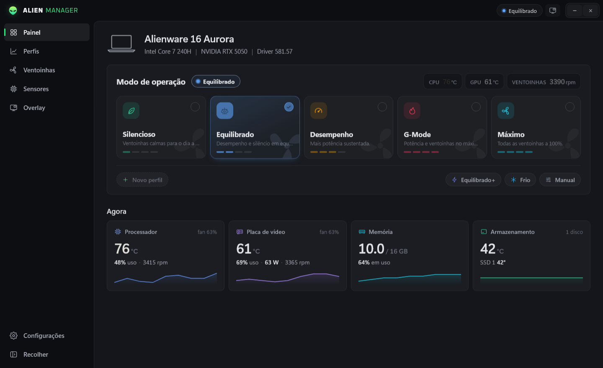
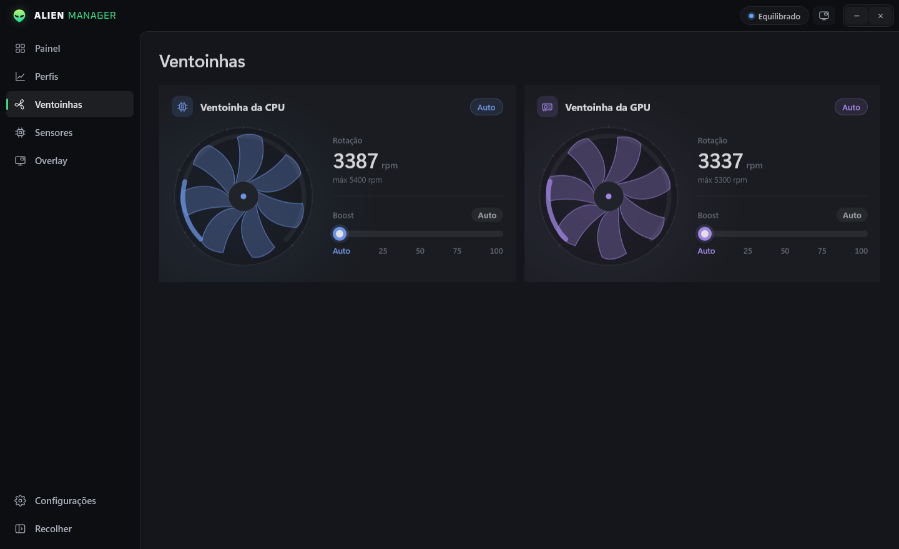
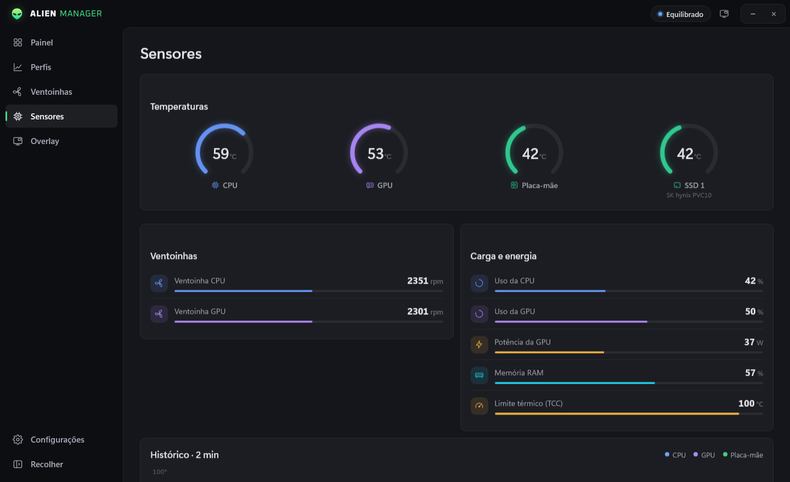
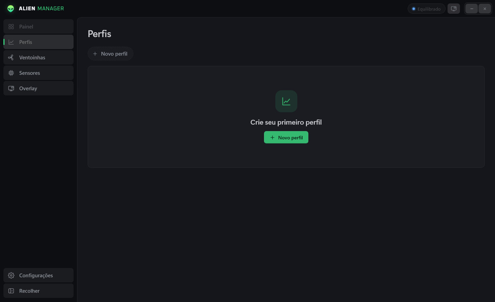
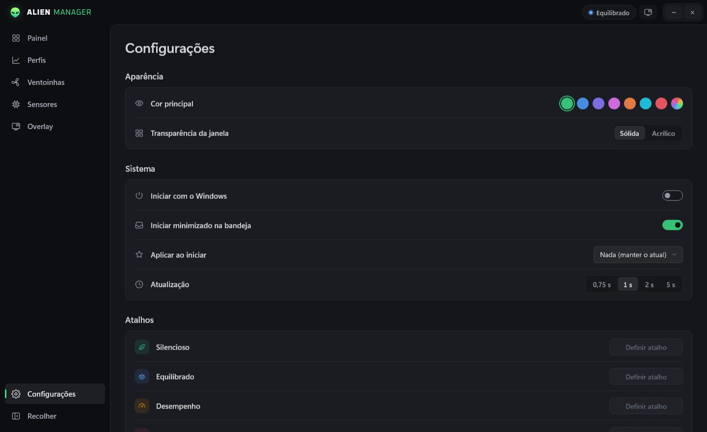
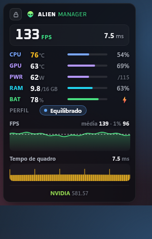
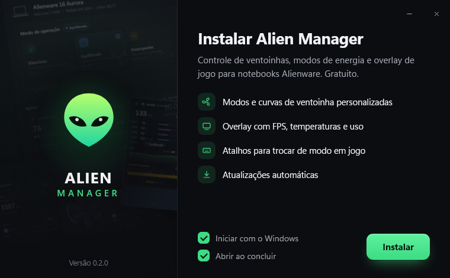

# Alien Manager

**Controle de ventoinhas, modos de energia e overlay de jogo para notebooks Alienware.**
Gratuito, leve e sem bloatware.

## Recursos

- **Modos de operação**: Silencioso, Equilibrado, Desempenho, G‑Mode, Máximo e os perfis do BIOS, num clique.
- **Perfis personalizados**: crie curvas de ventoinha por temperatura, com nome, ícone, cor e limite térmico (TCC) próprios.
- **Atalhos globais**: associe uma tecla a cada modo ou perfil e troque no meio do jogo. Um aviso na tela confirma a troca.
- **Overlay de jogo**: FPS, tempo de quadro, gráficos, temperaturas, uso de CPU/GPU, potência da GPU e RAM. Quatro níveis de detalhe, transparência ajustável e alerta visual acima de 85 °C.
- **Ventoinhas e sensores**: rotação ao vivo, boost manual, temperaturas de CPU, GPU, placa‑mãe e SSD.
- **Atualizações automáticas**: o app avisa quando há versão nova e atualiza em um clique.
- **Do seu jeito**: cor principal, Mica/Acrílico do Windows 11, iniciar com o Windows, minimizar na bandeja.

## Capturas

| Ventoinhas | Sensores |
|:-:|:-:|
|  |  |
| **Perfis** | **Configurações** |
|  |  |

<table>
  <tr>
    <td align="center"><b>Overlay em jogo</b> </td>
    <td align="center"><b>Aviso de troca de modo</b>   <b>Instalador</b> </td>
  </tr>
</table>

## Instalação

1. Baixe **AlienManager-Setup.exe** na página de [releases](https://github.com/matheus11999/alienmanager/releases/latest).
2. Execute e clique em **Instalar**. Pronto.

> O Windows pode mostrar o aviso do SmartScreen porque o instalador ainda não tem assinatura de código. Clique em **Mais informações → Executar assim mesmo**.

Também há uma versão **portátil** (.zip) na mesma página, que roda sem instalar.

**Requisitos:** Windows 10 ou 11 (64 bits), notebook Alienware ou Dell G com AWCC/BIOS compatível. O app pede permissão de administrador porque conversa direto com o controlador térmico.

## Atalhos padrão

| Atalho | Ação |
|---|---|
| `Ctrl + Shift + O` | Mostrar/ocultar o overlay |
| `Ctrl + Shift + L` | Travar/destravar o overlay |
| Definidos por você | Trocar de modo ou perfil (Configurações → Atalhos) |

## Próximos passos

O Alien Manager é **gratuito e vai continuar recebendo atualizações e novos recursos**. Na fila: benchmarks, pontuação de desempenho e mais.

## Créditos

- O controle de hardware é baseado no SDK **alienfan** do projeto [alienfx-tools](https://github.com/T-Troll/alienfx-tools) (licença MIT), via interface WMI do AWCC.
- Captura de FPS com [Intel PresentMon](https://github.com/GameTechDev/PresentMon) (licença MIT, incluída em `docs/LICENSE-PresentMon.txt`).
- Desenvolvido com ajuda de IA.

O código‑fonte não é público. Uso gratuito; veja [LICENSE](LICENSE).

---

Alien Manager é um projeto independente, sem afiliação com a Dell Technologies ou com a marca Alienware. Alienware é marca registrada de seus respectivos donos.
