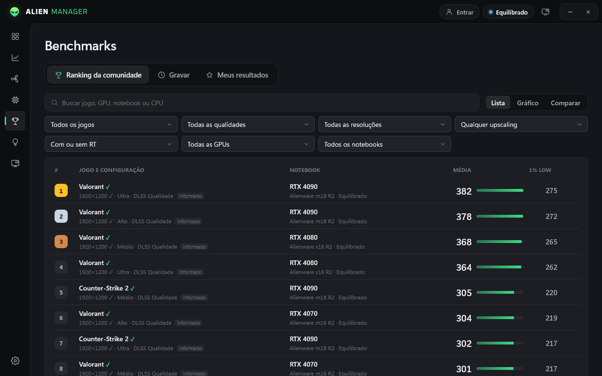
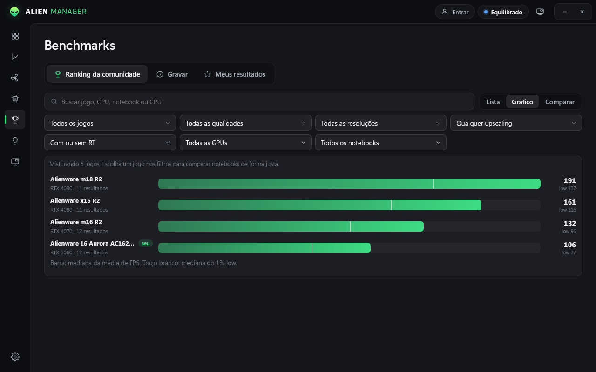
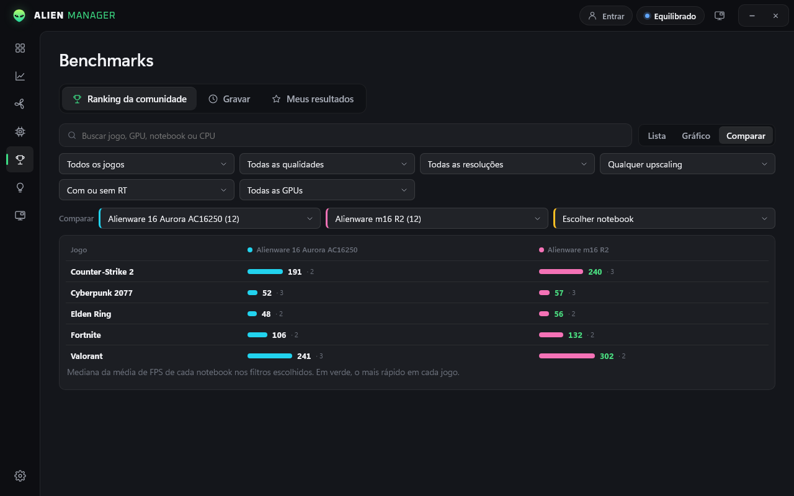
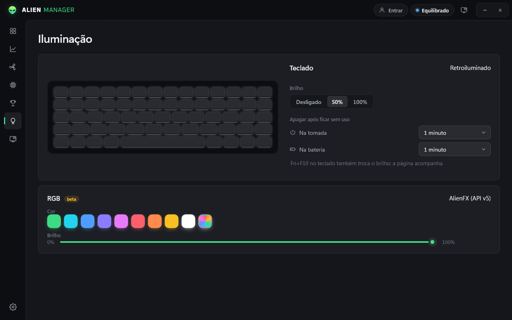
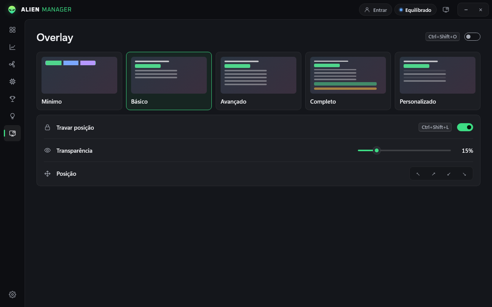

# Alien Manager

**Controle de ventoinhas, modos de energia, overlay de jogo e benchmarks para notebooks Alienware.**
Gratuito, leve e sem bloatware.

## Recursos

- **Painel**: temperaturas de CPU e GPU em destaque, uso, potência, memória, armazenamento e bateria.
- **Modos de operação**: Silencioso, Equilibrado, Desempenho, G‑Mode, Máximo e os perfis do BIOS, num clique.
- **Perfis personalizados**: crie curvas de ventoinha por temperatura, com nome, ícone, cor e limite térmico (TCC) próprios.
- **Atalhos globais**: associe uma tecla a cada modo ou perfil e troque no meio do jogo. Um aviso na tela confirma a troca.
- **Overlay de jogo**: FPS, média da sessão, 1% low, tempo de quadro, temperaturas, uso de CPU/GPU, potência, RAM e bateria. Escolha cada linha, ajuste a transparência e veja o alerta acima de 85 °C.
- **Benchmarks da comunidade**: grave uma sessão de jogo e compare com outros jogadores. Ranking aberto a todos, com busca, filtros por jogo, qualidade, resolução, upscaling e GPU, gráfico por notebook e comparação lado a lado.
- **Resultados confiáveis**: o FPS é recalculado no servidor a partir dos quadros gravados e assinados pelo app, o jogo é identificado pelo executável e resultados fora da curva ficam ocultos até revisão.
- **Contas e níveis**: crie sua conta no próprio app (só usuário e senha) e ganhe XP jogando com o overlay ligado, de Iniciante a Lenda.
- **Iluminação**: brilho do teclado e tempo para apagar na tomada e na bateria; RGB AlienFX em beta.
- **Ventoinhas e sensores**: rotação ao vivo, boost manual, temperaturas de CPU, GPU, placa‑mãe e SSD.
- **Atualizações automáticas**: o app avisa quando há versão nova e atualiza em um clique, mostrando as novidades.
- **Do seu jeito**: cor principal, Mica/Acrílico do Windows 11, iniciar com o Windows, minimizar na bandeja.

## Capturas

<b>Ranking da comunidade</b> 

| Gráfico por notebook | Comparação lado a lado |
|:-:|:-:|
|  |  |
| **Ventoinhas** | **Sensores** |
|  |  |
| **Perfis** | **Iluminação** |
|  |  |
| **Overlay** | **Configurações** |
|  |  |

<table>
  <tr>
    <td align="center"><b>Overlay em jogo</b> </td>
    <td align="center"><b>Aviso de troca de modo</b>   <b>Instalador</b> </td>
  </tr>
</table>

## Instalação

1. Baixe **AlienManager-Setup-x.y.z.exe** na página de [releases](https://github.com/matheus11999/alienmanager/releases/latest).
2. Execute e clique em **Instalar**. Pronto.

> O Windows pode mostrar o aviso do SmartScreen porque o instalador ainda não tem assinatura de código. Clique em **Mais informações → Executar assim mesmo**.

Também há uma versão **portátil** (.zip) na mesma página, que roda sem instalar.

**Requisitos:** Windows 10 ou 11 (64 bits), notebook Alienware ou Dell G com AWCC/BIOS compatível. O app pede permissão de administrador porque conversa direto com o controlador térmico.

## Atalhos padrão

| Atalho | Ação |
|---|---|
| `Ctrl + Shift + O` | Mostrar/ocultar o overlay |
| `Ctrl + Shift + L` | Travar/destravar o overlay |
| `Ctrl + Shift + R` | Reiniciar a média de FPS da sessão |
| `Ctrl + Shift + B` | Iniciar/parar a gravação de um benchmark |
| Definidos por você | Trocar de modo ou perfil (Configurações → Atalhos) |

## Privacidade

O app envia, de forma anônima, a versão, o modelo do notebook e mensagens de erro, para aperfeiçoar o programa e corrigir incompatibilidades com mais modelos. Nenhum dado pessoal é coletado. Dá para desligar no instalador ou em **Configurações → Geral**. A conexão com o servidor é criptografada.

## Próximos passos

O Alien Manager é **gratuito e vai continuar recebendo atualizações e novos recursos**.

## Créditos

- O controle de hardware é baseado no SDK **alienfan** do projeto [alienfx-tools](https://github.com/T-Troll/alienfx-tools) (licença MIT), via interface WMI do AWCC.
- Captura de FPS com [Intel PresentMon](https://github.com/GameTechDev/PresentMon) (licença MIT, incluída em `docs/LICENSE-PresentMon.txt`).
- Desenvolvido com ajuda de IA.

O código‑fonte não é público. Uso gratuito; veja [LICENSE](LICENSE).

---

Alien Manager é um projeto independente, sem afiliação com a Dell Technologies ou com a marca Alienware. Alienware é marca registrada de seus respectivos donos.
